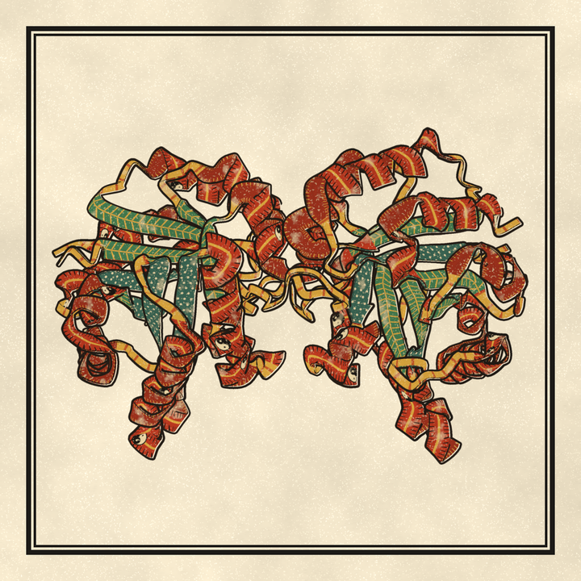

# molart — Đông Hồ painting

**Website: https://duynth29.github.io/molart/** · **Repo: https://github.com/duynth29/molart**

Real protein structures drawn as [**Đông Hồ painting**](https://en.wikipedia.org/wiki/%C4%90%C3%B4ng_H%E1%BB%93_painting) (Northern Vietnamese traditional art):
folk woodblock prints from Đông Hồ village, in the browser.



[Đông Hồ painting](https://en.wikipedia.org/wiki/%C4%90%C3%B4ng_H%E1%BB%93_painting) is a Northern Vietnamese folk art: Đông Hồ village (Bắc Ninh) has printed pictures for Tết for centuries, one carved block per colour,
natural pigments on dó paper coated with điệp (crushed scallop shell), and a black key block pressed last.
This renderer prints the protein the same way:

- **Helices** in đỏ son (laterite red), with comb hatching cut from the edges like the bristles of
  *Lợn nái* or the feathers of *Gà trống*, and the occasional âm dương swirl.
- **Strands** as verdigris (gỉ đồng) leaves with sophora-yellow veins, indigo (chàm) undersides with rice-grain dots.
- **Loops** in vàng hoè (sophora yellow).
- Colour blocks printed slightly out of register with a thick charcoal (than lá tre) key line; pigment
  sits unevenly and the shell coating glints through where the block printed thin.

## Prints

Choose a well-known Đông Hồ print; each lends its palette and motifs to the ribbons (the protein's
shape is never changed into the print's figures):

| Print | Helices | Strands |
|---|---|---|
| Lợn nái (Sow) | laterite red, comb bristles, âm dương swirls | verdigris leaves |
| Gà trống (Rooster) | red and yellow feather rows | dark green tail feathers |
| Đám cưới chuột (Mouse Wedding) | grey fur strokes | wedding red with dots |
| Vinh hoa · Phú quý | peach lotus petals | green pond waves |
| Hứng dừa (Coconuts) | palm-green fronds | ringed coconut trunks |
| Thầy đồ cóc (Toad Teacher) | warty olive toad skin | indigo scholar robes |
| Bà Triệu · Hai Bà Trưng | red armour scales, gold edges | gold banners |

## Text

Add a title or verse to the exported print (the **Text** button): across the top, along the bottom, or as a
vertical column of words at the side; woodblock serif or brush script; black or red ink. Vietnamese diacritics
are supported, and the protein shrinks to leave room for the words.

## Features

- **Coordinates never change.** Every effect lives in display geometry and shaders.
- **Science | Art.** Science mode keeps the ribbon geometry; art mode (opt-in, labelled) swells helices into
  the plump rounded forms of the prints and curls the loops.
- **Local.** Files you open stay in your browser. Fetching by PDB ID is an explicit button and
  goes to files.rcsb.org.
- **Export.** PNG up to 4K, printed on shimmering giấy điệp paper with a framed border (untick *Paper & frame* for plain white).

## Run

Requires Node 20 or newer.

```sh
npm install
npm run dev        # http://localhost:5173
npm run build      # static site in dist/
```

## Command line

Renders with the same code as the app, in headless Chromium
(`npx playwright-core install chromium`).

```sh
node cli/molart.mjs render public/samples/1TIM.cif --width 2400 --height 2400 --output 1tim.png   # on paper; --plain for white
node cli/molart.mjs render public/samples/1TIM.cif --style dongho-ga --text 'Phúc Lộc Thọ' --text-position side --text-color red --output ga.png
node cli/molart.mjs styles                                      # list the prints
python3 scripts/dongho_paper.py plain.png print.png         # same paper as a standalone script (Pillow, numpy)
```

## Credits

- Fork of [molart](https://github.com/martin-steinegger/molart) by Martin Steinegger, which renders the
  same structures in many artist-inspired styles; this fork keeps only the Đông Hồ style.
- molart was inspired by Sergey Ovchinnikov's protein structure visualization in
  [LocalFold](https://github.com/sokrypton/localfold).
- Sample structures in `public/samples/` (1TIM, 3CHY, 1UBQ, 4HHB) are unmodified downloads from
  the [RCSB PDB](https://www.rcsb.org) (CC0 1.0).

## License

MIT, see [LICENSE](LICENSE).
